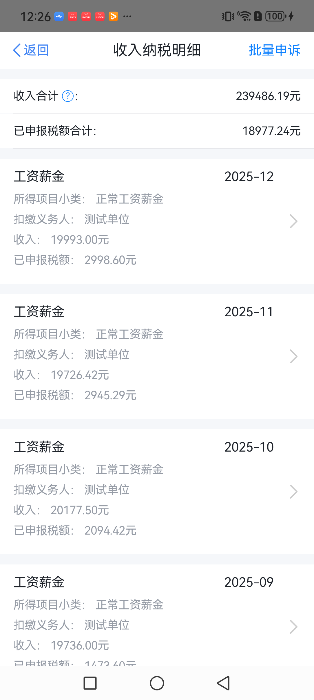

# 个税模拟器：Gitee 国内阅读入口

个税模拟器（个人所得税模拟器 / Geshui Simulator）支持 Android 安卓与 iPhone / iOS 的非官方界面教学演示。这里集中提供 Gitee 仓库里的截图和中文教程，方便在国内直接阅读。

**演示版本与使用咨询：QQ `2430239942`**。联系时说明手机机型、系统版本和演示目标。

## 项目入口

- [Gitee 国内公开仓库](https://gitee.com/MouJC/geshui-simulator)
- [GitHub 主仓库](https://github.com/Mou652/geshui-simulator)
- [个税模拟器官网：安卓与 iPhone 教程](https://geshui.moujc.cn/?utm_source=gitee&utm_medium=repository&utm_campaign=geshui_demo&utm_content=domestic_guide)
- [项目介绍与界面截图](README.md)

## 直接阅读教程

下列文档和图片都保存在仓库内。在 Gitee 打开本页时，点击即可在 Gitee 阅读对应内容。

| 需要解决的问题 | 中文教程 |
| --- | --- |
| 第一次使用，如何确认安卓或 iPhone 演示版本？ | [首次使用与版本说明](docs/guides/getting-started.md) |
| 如何配置虚构姓名、任职单位、年度收入和月份？ | [演示资料设置](docs/guides/configure-demo-data.md) |
| 如何查询本机收入纳税明细、核对月度记录？ | [演示收入明细浏览](docs/guides/income-details-demo.md) |
| iPhone 如何截图、连续录屏并配合旁白？ | [截图、录屏与演示分镜](docs/guides/screenshot-and-recording.md) |
| 个税 App、个人所得税计算器和模拟器有什么区别？ | [个税工具与教学入口](docs/guides/tax-app-and-simulator.md) |
| 找不到设置入口，或保存后仍没有明细怎么办？ | [个税模拟器常见问题排查](docs/guides/troubleshooting.md) |
| 项目支持哪些功能，适合哪些演示场景？ | [项目资料与功能说明](docs/project-overview.md) |

## 界面预览

<table>
  <tr><th>收入纳税明细 · 虚构示例</th><th>年度查询 · 模拟演示</th></tr>
  <tr>
    <td></td>
    <td></td>
  </tr>
</table>

当前截图和分步按钮路径以 iPhone 版为例。Android 的具体入口与功能范围以对应版本说明为准。

## 版本与问题反馈

公开仓库提供介绍、教程和截图，不包含可构建的 App 源码，也没有通用安装包下载链接。演示版本、适用设备与获取方式可通过 QQ **2430239942** 确认。

可通过 [Gitee Issues](https://gitee.com/MouJC/geshui-simulator/issues) 或 [GitHub Issues](https://github.com/Mou652/geshui-simulator/issues) 反馈问题。请说明演示版本、设备、复现步骤，以及使用的虚构示例。

本项目与税务机关及官方 App 无关联，不连接官方税务系统。对外展示时注明“个税模拟器 / 非官方模拟演示”，演示画面不作为真实收入、纳税或身份材料。
