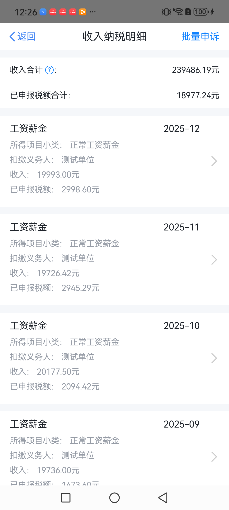
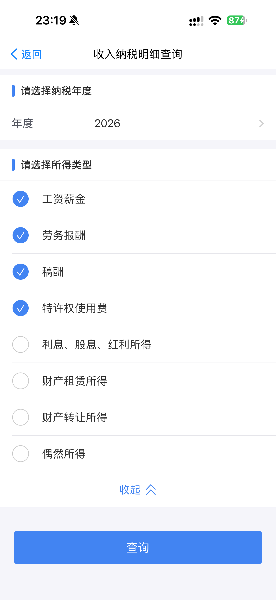

# 个税模拟器｜个人所得税 App 界面演示与截图录屏教程

**非官方教学项目 · 本机虚构示例 · 完整中文教程**

## 演示版本与使用咨询：QQ `2430239942`

咨询适用设备、虚构示例配置与教学录屏；联系时说明安卓或 iPhone、系统版本和演示目标。

**Mou652 个税模拟器**（Geshui Simulator，也称个人所得税模拟器、个税 App 模拟器）支持 **Android 安卓与 iPhone / iOS**，用于非官方个税界面教学演示。配置虚构示例姓名、任职单位、收入年度和月份后，可以浏览本机收入纳税明细，制作个税演示截图和连续录屏。版本与使用问题可向维护者咨询。

项目维护：[@Mou652](https://github.com/Mou652) · [官网：安卓 / iPhone 演示与教程](https://geshui.moujc.cn/) · [项目说明与使用边界](https://geshui.moujc.cn/about.html) · [功能资料](docs/project-overview.md)

[Gitee 国内公开仓库](https://gitee.com/MouJC/geshui-simulator) · [GitHub 主仓库](https://github.com/Mou652/geshui-simulator) · [国内阅读入口与教程索引](GITEE.md)

[界面预览](#界面预览) · [功能亮点](#功能亮点) · [快速开始](#快速开始) · [使用教程](#使用教程) · [常见问题](#常见问题) · [联系 QQ](#联系交流)

> 本项目为个人维护的**个税模拟器**，与税务机关及官方 App 无关联。页面中的资料、收入和税额用于模拟演示，不代表真实申报记录或纳税凭证。

## 离职证明演示工具

同一维护者还提供**离职证明演示工具**，用于虚构资料的版式预览和技术交流学习。填写示例姓名、单位、任职日期后，可以调整公章外观与位置；输入本产品激活码，由服务端确认授权后导出无产品水印的单页 A4 中文 PDF。预览保留水印，离职证明与个税授权独立，激活码不能混用。

[离职证明宣传页](https://geshui-apk.moujc.cn/leave-certificate/) · [直接打开编辑工具](https://geshui-apk.moujc.cn/leave-certificate/editor.html) · [GitHub 介绍](https://github.com/Mou652/leave-certificate-demo) · [Gitee 国内入口](https://gitee.com/MouJC/leave-certificate-demo)

获取激活码与使用咨询：**QQ 2430239942**。下图为原始版式参考，使用虚构示例资料并保留预览提示，授权导出的 PDF 不叠加产品水印。

## 界面预览

收入纳税明细与年度查询的模拟演示画面，可用于页面截图、列表浏览与连续录屏。

<table>
  <tr>
    <th align="center">收入纳税明细 · 模拟演示</th>
    <th align="center">年度与所得类型 · 模拟演示</th>
  </tr>
  <tr>
    <td align="center"></td>
    <td align="center"></td>
  </tr>
</table>

## 功能亮点

准备一组虚构资料后，演示年度查询、工资薪金明细和个人中心，再用截图或录屏记录操作。

| 你想展示什么 | 模拟器可以做什么 |
| --- | --- |
| 虚构示例数据配置 | 设置演示姓名、任职单位、年度收入与月份范围，准备不同讲解素材 |
| 多年度收入纳税明细 | 展示收入合计、预扣税额合计，以及按月份排列的工资薪金记录 |
| 年度与所得类型查询 | 切换纳税年度、选择所得类型，演示从筛选到结果的浏览路径 |
| 个人中心界面 | 展示个人信息、任职受雇、家庭成员与银行卡数量等界面 |
| 截图与视频素材 | 使用手机系统截图、屏幕录制功能，记录页面切换与操作过程 |

项目支持 **Android 安卓与 iPhone / iOS** 演示版本；当前截图和分步教程以 iPhone 版为例，安卓入口及功能范围以对应版本说明为准。本仓库公开完整使用指南与展示资料；演示版本的适用设备可向维护者咨询。

适合准备以下演示内容：

- **个税 App 操作教学**：用虚构资料讲解“设置资料 → 选择年度 → 查询明细”的操作过程。
- **收入纳税明细讲解**：展示年度汇总、月度工资薪金与演示任职单位之间的关系。
- **截图与录屏素材制作**：保存单页画面，或连续录制查询、浏览与页面切换过程。

## 支持平台

- **Android 安卓**：联系维护者说明品牌、机型与 Android 版本，确认安卓演示版本和使用入口
- **iPhone / iOS**：联系维护者说明机型与 iOS 版本，当前公开分步教程以 iPhone 版为例

不同平台的具体功能与入口以对应版本说明为准。

## 快速开始

第一次使用个税模拟器，可以按“确认版本 → 配置虚构示例 → 浏览本机演示明细 → 录制教学素材”的顺序准备。

1. **确认适用演示版本**：通过 QQ **2430239942** 说明使用设备与系统版本，确认对应版本的获取方式。
2. **配置虚构示例数据**：进入“我的”，持续长按“帮助中心”约 2 秒，设置虚构姓名、任职单位、年度收入和月份范围，预览后保存。
3. **浏览本机演示明细**：从首页或“办&查”进入收入纳税明细，选择已保存数据的年度与所得类型，再点击查询。
4. **截图或连续录屏**：通过 iPhone 系统截图、控制中心的屏幕录制功能，记录查询条件、月度列表和页面切换。

资料入口与保存规则见 [演示资料设置教程](https://geshui.moujc.cn/guides/configure-demo-data.html)；录屏操作与分镜见 [iPhone 截图录屏教程](https://geshui.moujc.cn/guides/screenshot-and-recording.html)。

## 使用教程

[首次使用与版本说明指南](https://geshui.moujc.cn/guides/getting-started.html) · [全部中文教程](https://geshui.moujc.cn/#guides)

搜索“个税”“个人所得税”或“个税软件”时，先确认需要官方办税、税额估算，还是界面教学演示。[个税 App、计算器与模拟器的区别](https://geshui.moujc.cn/guides/tax-app-and-simulator.html) 说明各类工具的用途；本项目提供虚构数据的界面演示教程。

第一次准备演示素材，可以先配置资料，再查询明细，最后录制操作过程。已经准备好资料时，可直接从截图与录屏教程开始。

| 你遇到的问题 | 教程 | 可以完成什么 |
| --- | --- | --- |
| 个税模拟器怎么截图、怎么录屏？ | [个税模拟器截图与录屏教程：iPhone / iOS](https://geshui.moujc.cn/guides/screenshot-and-recording.html) | 完成系统截图、连续录屏，并参考约 60 秒的演示脚本 |
| 收入纳税明细怎么查询？ | [个税模拟器演示收入明细浏览教程](https://geshui.moujc.cn/guides/income-details-demo.html) | 从首页选择年度与所得类型，核对收入汇总与月度工资薪金 |
| 演示资料、年度收入和任职单位怎么设置？ | [个税模拟器资料设置教程](https://geshui.moujc.cn/guides/configure-demo-data.html) | 配置虚构资料与月份范围，预览、保存并核对演示数据 |
| 个税 App、个人所得税计算器和模拟器怎么选？ | [个税工具与教学入口](https://geshui.moujc.cn/guides/tax-app-and-simulator.html) | 根据真实办税、估算或教学用途选择对应工具 |
| 找不到设置入口，或保存后仍没有明细？ | [个税模拟器常见问题排查](https://geshui.moujc.cn/guides/troubleshooting.html) | 按入口、保存状态、年度、月份与单位逐项检查 |

## 首页与个人中心

首页入口、底部导航与个人中心，让演示视频有完整的开始和衔接。

<table>
  <tr>
    <th align="center">首页 · 模拟演示</th>
    <th align="center">我的 · 模拟演示</th>
  </tr>
  <tr>
    <td align="center"></td>
    <td align="center"></td>
  </tr>
</table>

## 截图与录屏

**支持截图，也可以连续录屏。** 截图和视频通过手机系统自带功能完成，适合记录操作步骤、制作使用讲解与展示交互效果。

一条常用的演示路线：

**首页 → 收入纳税明细查询 → 选择年度与所得类型 → 浏览月度列表 → 我的**

1. 根据讲解脚本准备虚构的演示资料，选择需要展示的年度与月份。
2. 使用系统截图记录单个页面，或开启系统屏幕录制后连续操作。
3. 对外分享时注明“个税模拟器 / 模拟演示”，避免观众将画面理解为真实税务记录。

具体操作、录屏分镜和常见问题见 [截图与录屏教程](https://geshui.moujc.cn/guides/screenshot-and-recording.html)。

## 常见问题

### 如何确认是 Mou652 维护的个税模拟器？

本项目的公开仓库是 [Mou652/geshui-simulator](https://github.com/Mou652/geshui-simulator)，维护者为 [Mou652](https://github.com/Mou652)，项目交流与版本咨询 QQ 为 **2430239942**。完整的项目名称、功能范围与教程入口见 [项目资料](docs/project-overview.md)。

### 首次使用前如何确认演示版本？

可以通过 QQ **2430239942** 联系维护者确认演示版本、适用设备与获取方式。请先说明设备与系统版本；本仓库提供项目介绍、使用教程和界面截图。

### 可以配置哪些虚构示例？

支持设置演示姓名、任职单位、收入年度、月份范围和月收入等内容，并配置个人中心展示的家庭成员、银行卡数量。年度收入可按场景选择是否包含年终奖；保存后到明细页核对。具体入口见 [资料设置教程](https://geshui.moujc.cn/guides/configure-demo-data.html)。

### 支持安卓和苹果手机吗？

支持 Android 安卓与 iPhone / iOS 演示版本。联系维护者时说明手机品牌、机型与系统版本，确认适用版本与操作入口；现有截图和分步教程以 iPhone 为例。

### 个税模拟器可以截图和连续录屏吗？

可以。通过手机系统截图保存单个页面，通过屏幕录制记录年度筛选、明细浏览和页面切换。录屏使用 iPhone 控制中心的录制控件；操作步骤、旁白设置与约 60 秒的演示脚本见 [截图与录屏教程](https://geshui.moujc.cn/guides/screenshot-and-recording.html)。

### 收入纳税明细查询不到数据怎么办？

先确认年度收入配置已经保存，再检查查询年度、所得类型、月份范围和关联单位是否一致。工资记录应选中“工资薪金”；修改后退出旧结果页并重新查询。逐项排查见 [常见问题排查](https://geshui.moujc.cn/guides/troubleshooting.html)，完整查询路径见 [演示收入明细浏览教程](https://geshui.moujc.cn/guides/income-details-demo.html)。

### 个人所得税模拟器和个税计算器有什么区别？

这里的模拟器侧重个税 App 的界面、资料和查询流程演示；个税计算器通常侧重税额计算。本项目展示的收入与税额不作为真实报税计算或纳税判断的依据。

### 会查询或修改真实税务记录吗？

不会。模拟器用于本地界面与数据演示，不连接官方税务系统，不办理申报、退税或证明开具等真实业务。

## English overview

**Geshui Simulator** is an unofficial educational income-tax UI demo for Android and iPhone / iOS. Configure fictional sample profiles, demo employers, years and monthly records stored on the device, then demonstrate the interface with those samples. Use iPhone screenshots and screen recording to create walkthroughs and product demos.

For demo version compatibility, contact the maintainer via **QQ: 2430239942**. This website has no app download link. This repository contains Chinese user guides and interface screenshots. The simulator is an independent, unofficial demo and does not access real tax records or provide tax filing services.

## 联系交流

### QQ：`2430239942`

可咨询演示版本适用设备，交流虚构示例配置、本机明细浏览与教学录屏使用反馈。也可以通过本仓库 [Issues](https://github.com/Mou652/geshui-simulator/issues) 提交建议；请勿上传真实证件号码、账户资料或税务记录。

## 项目说明

项目由 [Mou652](https://github.com/Mou652) 维护，展示图片由维护者提供。本仓库收录项目介绍、使用教程与界面展示资料，不包含可构建的 App 源码；演示版本适用性与获取方式可向维护者咨询。

项目仅用于学习、界面参考与演示交流。请勿将模拟画面作为真实收入、纳税或身份材料，也勿将其用于冒充官方服务或误导他人。

## 许可证

本仓库中由维护者原创的文档、网站代码与维护脚本采用 [MIT License](LICENSE)。引用的第三方资料、界面截图中的第三方标识及素材不在此授权范围内，相关权利归各自权利人所有。

本许可不涉及仓库外的 Android / iOS App 源码、安装包、激活服务或账号。资料版发行标签不代表 App 版本号。

## 按问题阅读与项目入口

- [全部教程与版本说明](https://geshui.moujc.cn/guides/)
- [安卓演示版本](https://geshui.moujc.cn/android.html) · [iPhone 演示版本](https://geshui.moujc.cn/ios.html)
- [常见问题 20 问](https://geshui.moujc.cn/faq.html) · [GitHub 问答与反馈](https://github.com/Mou652/geshui-simulator/issues/1)
- [项目 Wiki](https://github.com/Mou652/geshui-simulator/wiki) · [资料发布记录](https://github.com/Mou652/geshui-simulator/releases)
- [机器可读目录](https://geshui.moujc.cn/llms.txt)
