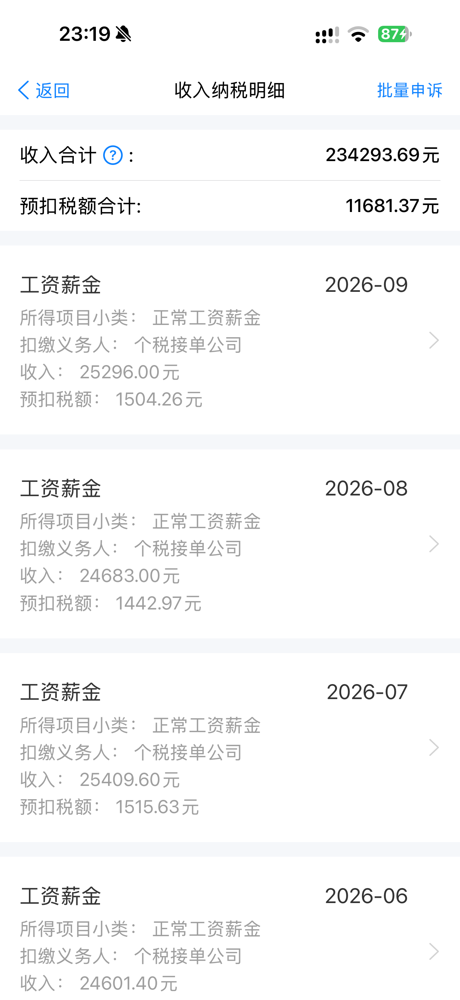

# 收入纳税明细界面演示流程：年度查询与月度列表

这篇教程帮助你用个税模拟器展示收入纳税明细查询：从首页进入查询页，选择纳税年度和所得类型，再浏览收入汇总与月度记录。适合制作流程讲解、页面截图和连续录屏。

文中的资料和金额均用于模拟演示，不是从官方税务系统查询的记录。开始前，请先在模拟器中保存一组需要展示的年度资料。

[返回项目首页](../../README.md) · [配置演示资料](configure-demo-data.md) · [录制查询过程](screenshot-and-recording.md)

## 第一步：从首页进入查询

在首页找到“收入纳税明细”入口，进入查询页；也可以通过底部“办&查”中的查询入口进入。

进入后，先确认页面显示纳税年度和所得类型，暂时不要急着查询。录屏讲解时，这一步可以用来说明查询条件和结果列表之间的关系。

## 第二步：选择有演示记录的年度

点击“年度”，选择已经配置数据的年份。例如，你准备了 2026 年 1—3 月的工资记录，就选择 2026 年。

如果要演示跨年度切换，先分别准备两组年度数据，再依次查询。查询一个年度时，只核对该年度内的月份，不把另一个年度的记录计入本次讲解。

## 第三步：选择所得类型

按演示内容选择所得类型。主要讲解工资记录时，选择“工资薪金”；其他类型根据本次准备的数据选择。

查询页里勾选了某个类型，并不代表已经生成该类型的记录。列表能否显示内容，还取决于本机是否保存了相应的演示数据。

## 第四步：查询并阅读汇总

点击“查询”进入收入纳税明细列表。先停留在顶部，查看收入合计与预扣税额合计，再逐条浏览月份。

| 展示字段 | 讲解时关注什么 |
| --- | --- |
| 收入合计 | 当前查询结果对应的收入汇总 |
| 预扣税额合计 | 与本次结果对应的模拟预扣税额展示值 |
| 所属年月 | 每条记录对应的演示月份 |
| 所得项目小类 | 这条记录采用的所得分类 |
| 扣缴义务人 | 记录关联的演示任职单位 |
| 收入与预扣税额 | 单条记录对应的演示金额 |

截图里的金额是一组展示示例。你的查询结果取决于本机保存的资料，不需要与截图逐字、逐数一致。

## 第五步：核对记录，再截图或录屏

1. 对照已配置的月份范围，检查列表是否出现需要展示的月份。
2. 核对演示单位名称，避免讲解时引用了另一家单位的数据。
3. 需要展示单条记录时，进入详情页查看该月信息；结束后返回列表。
4. 需要演示另一个年度时，返回查询条件，切换年度后再次查询。

建议先展示列表顶部的汇总，再缓慢滚动到后续月份。完整录制步骤和分镜示例见 [个税模拟器如何截图与录屏](screenshot-and-recording.md)。

## 查询结果不符合预期时

| 遇到的情况 | 先检查什么 |
| --- | --- |
| 查询后没有记录 | 是否保存过对应年度的数据，是否选中了记录所属的所得类型 |
| 只有部分月份 | 配置的起止月份是否与讲解脚本一致 |
| 单位名称不符合预期 | 当前记录关联的是哪家演示任职单位 |
| 修改资料后还是旧内容 | 修改是否已经保存，是否退出旧结果页并重新查询 |
| 每月收入不是完全相同的数值 | 当前年度配置可能生成了月薪附近的浮动演示金额，以保存后的记录为准 |

遇到缺少数据的情况，先返回 [资料配置教程](configure-demo-data.md) 补齐并保存，再重新查询，不需要反复点击查询按钮。

## 演示范围与交流

本教程展示查询与浏览路径。页面里的申报、申诉或证明等入口不代表真实税务办理结果；演示画面不能作为收入或纳税证明。

个税模拟器使用交流：**QQ：2430239942**。反馈问题时，可以说明查询年度、所得类型和预期月份，不要上传真实税务资料。
